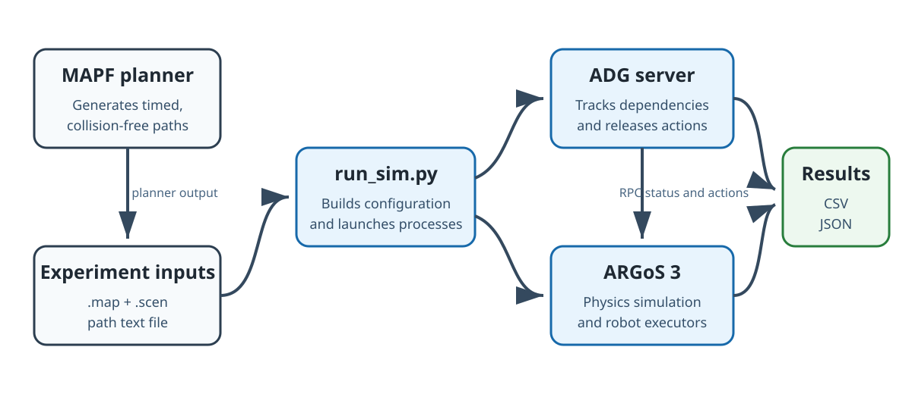

Multi-Agent Path Finding (MAPF) produces collision-free routes for multiple robots, but a valid grid plan is not automatically a safe or efficient execution plan. Real robots accelerate, decelerate, turn, drift, and experience delays. SMART (Scalable Multi-Agent Realistic Testbed) helps expose this gap by executing MAPF plans in a physics-based multi-robot simulation, coordinating them with an Action Dependency Graph, and reporting execution statistics. This tutorial explains the assumptions behind SMART, builds and runs the public implementation, connects a planner through SMART's text-file interface, and develops a repeatable method for comparing plans under realistic execution conditions.

## Why simulate a collision-free plan?

Classical MAPF represents the environment as a graph. At every discrete time step, an agent either waits at its current vertex or moves to an adjacent vertex. A solution normally prevents two common conflicts:

- a **vertex conflict**, in which two agents occupy the same vertex at the same time; and
- an **edge conflict**, in which two agents traverse the same edge in opposite directions at the same time.

This model is useful because it separates combinatorial planning from low-level robot control. It also introduces assumptions that should be tested before deployment. A grid step does not take exactly the same amount of wall-clock time for every robot. A robot entering a turn may need to slow down, while another robot on a straight segment maintains its speed. Wheel slip, controller error, communication delay, and variation in acceleration can move robots away from their nominal schedule. Two agents that are conflict-free at integer time steps can therefore approach the same physical region at unsafe times between those steps.

Plan cost alone can also be misleading. MAPF planners commonly optimize **makespan**, the time at which the last agent reaches its goal, or **sum of costs**, the sum of individual path durations. These values describe the discrete plan. The executed makespan can change when one plan contains more turns, closely coupled crossings, or dependencies that amplify a small delay. Evaluation should consequently answer two different questions:

1. Is the discrete plan valid in its planning model?
2. How does that plan behave when robots execute it with motion constraints and uncertainty?

SMART is intended for the second question. It consumes paths produced by a MAPF planner; it is not itself a MAPF solver.

## SMART architecture

The current public SMART repository combines ARGoS 3, an Action Dependency Graph (ADG) execution server, robot-side executors, and a Python launch script. The components and data flow are summarized below.



The main components are:

- **Planner and input files:** An external planner reads a grid map and a scenario, then writes one timed path per agent.
- **`run_sim.py`:** This is the supported user-facing entry point. It reads the experiment inputs, creates an ARGoS configuration, starts the ADG server, and launches ARGoS.
- **ADG server:** The server turns the plan into execution dependencies and communicates with robot executors using `rpclib`.
- **ARGoS and robot executors:** ARGoS simulates robot motion. Executors request and carry out actions while reporting progress to the server.
- **Outputs:** SMART writes an ARGoS configuration and a statistics CSV file; the ADG server also prints a JSON summary at the end of a run.

An ADG encodes ordering constraints between actions. A robot must preserve the order of actions along its own path, and actions involving interacting agents may require additional ordering. Instead of assuming that every robot advances in lockstep, the execution monitor releases an action when its prerequisites have completed. This allows a delayed agent to affect only actions that depend on it while preserving the plan's required coordination.

The public repository exposes this workflow through commands and files. It does not currently provide a packaged `SMARTClient` Python library, REST service, or documented pause/resume callback API. Planner integration should therefore target the documented path-file format rather than relying on internal RPC methods.

## Choosing between the web demo and a local build

The [SMART web demo](https://smart-mapf.github.io/demo/) is the quickest way to inspect the interface and visualize bundled examples. It is useful for familiarization, demonstrations, and checking whether a map or path looks correct.

A local source build is preferable when an experiment needs custom planner output, repeatable batch runs, headless execution, automated result collection, or changes to robot and uncertainty parameters. The public README specifies Ubuntu 22.04. The commands below should be run on Ubuntu 22.04 or an equivalent Linux environment; macOS and Windows are not documented build targets.

## Installing SMART on Ubuntu 22.04

Install the basic compiler and build dependencies:

```bash
sudo apt-get update
sudo apt-get install -y cmake g++ libboost-all-dev git
```

SMART uses [ARGoS 3](https://www.argos-sim.info/) as its robot simulator. Follow the ARGoS installation instructions for the target system. One source-build workflow is:

```bash
cd /tmp
git clone https://github.com/ilpincy/argos3.git
cd argos3
mkdir build
cd build
cmake ../src
make -j$(nproc)
sudo make install
```

Then clone SMART and initialize its submodules. The `rpclib` dependency used between the server and executors is included as a Git submodule, so omitting the submodule steps produces an incomplete source tree.

```bash
git clone https://github.com/smart-mapf/smart.git
cd smart
git submodule init
git submodule update
mkdir build
cd build
cmake -DCMAKE_BUILD_TYPE=Release ..
make -j$(nproc)
```

Verify that the server binary, ARGoS, and launch script are available:

```bash
ls -l server/ADG_server
argos3 -h
cd ..
python run_sim.py --help
```

If CMake cannot find ARGoS, confirm that ARGoS was installed and that its libraries and CMake metadata are on the environment's search paths. The SMART maintainers also note that Conda libraries in `PATH` can cause linking conflicts. Temporarily deactivate Conda and configure a clean build directory if an unexpected library is selected.

## Understanding SMART's input files

A reproducible run consists of a map, a scenario, a path file, and the command-line settings used to execute them. Keep all four with the experiment results.

### Map files

SMART reads the MovingAI `.map` format. A map begins with a header followed by a fixed-width character grid:

```text
type octile
height 5
width 5
map
@@@@@
@...@
@.@.@
@...@
@@@@@
```

The current SMART converter treats `@` and `T` as obstacles. Do not assume that every symbol recognized by other MovingAI tools will have the same meaning in SMART. Check that the declared height and width match the grid and that every row has equal length.

### Scenario files

A `.scen` file assigns start and goal cells. After `version 1`, every tab-separated row contains a bucket identifier, map name, map width, map height, start x, start y, goal x, goal y, and reference cost:

```text
version 1
0	example.map	5	5	1	1	3	3	4
0	example.map	5	5	1	3	3	1	4
```

Coordinates use a top-left origin: x increases to the right and y increases downward. Starts and goals must be within the grid and in free cells. The `--num_agents` argument determines how many agents are loaded from the scenario.

### Path files

The planner output is a text file with one line per agent. Each waypoint includes a grid coordinate and a discrete plan time:

```text
Agent 0:(1,1,0)->(2,1,1)->(3,1,2)->(3,2,3)->(3,3,4)->
Agent 1:(1,3,0)->(1,2,1)->(1,1,2)->(2,1,3)->(3,1,4)->
```

Consecutive waypoints must be axis-adjacent moves or waits. Diagonal jumps are not accepted by the current parser. There must be one path line for each simulated agent, and waypoints must stay within the map and avoid obstacles.

Coordinate order is a frequent source of incorrect experiments. Use `--flip_coord=0` when tuples are `(x,y,t)`. Use `--flip_coord=1` when the planner emits `(y,x,t)` row-column tuples. Visualize a small asymmetric test case before launching a large batch; symmetric maps can hide a coordinate swap.

## Running a first experiment

The repository includes maps, scenarios, and example paths. From the SMART repository root, run the documented 50-agent example with visualization:

```bash
python run_sim.py \
  --map_name=random-32-32-20.map \
  --scen_name=random-32-32-20-random-1.scen \
  --num_agents=50 \
  --path_filename=example_paths_xy.txt \
  --flip_coord=0
```

Before interpreting metrics, watch the visual run and check five things:

1. Robots begin at the intended scenario locations.
2. Obstacles align with the source map.
3. Robots follow the expected route orientation.
4. Turns and waits occur at the expected cells.
5. Every robot eventually reaches its assigned goal.

Once the experiment is visually correct, repeat it without rendering for faster batch evaluation:

```bash
python run_sim.py \
  --map_name=random-32-32-20.map \
  --scen_name=random-32-32-20-random-1.scen \
  --num_agents=50 \
  --path_filename=example_paths_xy.txt \
  --flip_coord=0 \
  --headless=True \
  --stats_name=baseline.csv
```

`run_sim.py` generates `output.argos` by default, starts `build/server/ADG_server`, and launches ARGoS. The default statistics file is `stats.csv`; setting `--stats_name` prevents one experimental condition from silently overwriting another. Parallel runs also need distinct RPC ports through `--port_num` and distinct output filenames.

## Connecting a MAPF planner

Planner integration is intentionally narrow: solve the same `.map` and `.scen` instance, serialize the paths, and pass the resulting file to SMART. The following Python function converts a list of planner paths into the required format:

```python
def write_smart_paths(paths, output_file):
    """Write paths[agent][step] = (x, y, t) for SMART."""
    with open(output_file, "w", encoding="utf-8") as stream:
        for agent_id, path in enumerate(paths):
            waypoints = "->".join(
                f"({x},{y},{time_step})"
                for x, y, time_step in path
            )
            stream.write(f"Agent {agent_id}:{waypoints}->\n")
```

Validate the conversion before simulation:

- The number of path lines equals `--num_agents`.
- Agent identifiers are unique and correspond to scenario rows.
- Every path starts at its scenario start and ends at its goal.
- Every transition is a wait or an axis-adjacent move.
- No waypoint is out of bounds or inside `@` or `T`.
- Tuple ordering agrees with `--flip_coord`.
- The discrete paths remain free of vertex and edge conflicts.

Keep planning time separate from execution time. SMART evaluates how an already generated plan executes; including the solver's runtime in simulated makespan would mix two different quantities. Record planner runtime alongside, rather than inside, SMART's execution metrics.

## Reading the results

The current server writes a CSV row and prints a JSON summary. Important fields include:

- **`original plan cost`:** a property of the discrete input plan;
- **`steps finish sim` and `time finish sim`:** completion measures for simulated execution;
- **`simulated makespan seconds`:** elapsed simulated time until the last agent finishes;
- **`simulated sum of cost seconds`:** aggregate executed travel time;
- **`#Move`, `#Rotate`, and `#Consecutive Move`:** action counts that help characterize the plan geometry;
- **`#type-1 edges`, `#type-2 edges`, and `#Nodes`:** properties of the execution dependency graph; and
- **`number of agent` and `instance name`:** identifiers needed when combining runs.

Field names may evolve, so archive the SMART commit hash and the raw CSV/JSON output instead of copying only selected values into a spreadsheet.

The most useful derived quantity is often the execution gap between two plans rather than a single absolute score. For example, compare planned makespan with simulated makespan and ask whether the ranking of planners changes after execution effects are introduced. A plan with fewer grid steps can execute more slowly if it contains many rotations or tightly coupled interactions.

## Designing a fair planner comparison

A strong evaluation changes one factor at a time and preserves the complete experiment configuration. Use the same map, scenario rows, number of agents, robot model, execution parameters, and SMART version for every planner being compared.

### 1. Begin with a correctness case

Use two to ten agents on a small map. Inspect paths manually and run with visualization. This stage catches formatting, coordinate, obstacle, and goal-assignment errors that can invalidate every later result.

### 2. Establish a deterministic baseline

Run each plan under the default or nominal execution settings. Record discrete cost, simulated makespan, simulated sum of costs, rotations, and ADG size. If the simulator or controller introduces randomness, set and record the seed when the relevant configuration supports one.

### 3. Vary execution conditions

Test conditions that represent the intended robot system, such as different velocity or acceleration limits, turn behavior, delay, or controller uncertainty. Do not claim that a parameter represents a physical robot unless it has been calibrated from measurements. SMART can reveal sensitivity, but realism depends on the model and parameter values supplied by the experimenter.

### 4. Repeat stochastic trials

A single noisy run is not evidence of robust behavior. Run enough trials to report a distribution. At minimum, provide the number of trials, mean or median, a measure of spread, and failure count. Keep failed or timed-out trials in the analysis rather than averaging only successful executions.

### 5. Scale density as well as robot count

Increasing agent count on a larger empty map may not increase interaction. Compare scenarios using occupancy or traffic density, bottleneck structure, and the number of interacting agent pairs. Warehouse aisles and narrow intersections often expose coordination differences better than open rooms.

### 6. Preserve provenance

For each result, save:

- planner name, version or commit, and parameters;
- SMART and ARGoS versions or commits;
- the exact map, scenario, and path files;
- the full launch command and environment information;
- raw CSV and JSON outputs; and
- any modified ARGoS, controller, or uncertainty configuration.

This information turns a visual demonstration into a repeatable engineering experiment.

## Common failure modes

### Robots move along transposed routes

The planner and SMART disagree about coordinate order. Confirm whether the path uses `(x,y)` or `(row,column)` and set `--flip_coord` accordingly. Test a start and goal whose x and y values differ.

### The map looks different from the planning map

Check row lengths and declared dimensions. The current converter treats `@` and `T` as obstacles; translate other obstacle symbols before running the experiment.

### The run has missing or extra robots

Compare `--num_agents`, the number of scenario entries selected, and the number of path lines. These values must describe the same agent set.

### CMake or the linker selects unexpected libraries

Use a clean build directory, verify the ARGoS installation, and deactivate Conda if its libraries conflict with system packages. Confirm that both the server binary and client controller library were built.

### A batch run overwrites earlier results

Give every condition a unique `--stats_name`. When executing jobs concurrently, also use unique `--port_num` values and separate working directories or generated ARGoS configuration names.

### A plan performs worse despite a better discrete cost

Inspect rotations, bottlenecks, interacting pairs, and ADG structure. The result may be legitimate: discrete objectives do not model every execution cost. Re-run matched trials before concluding that the difference is caused by planner design rather than noise or configuration.

## Limitations and appropriate use

SMART is valuable when a project uses grid-based MAPF and needs to study the gap between scheduled paths and multi-robot execution. It is especially helpful for comparing planner outputs, analyzing coordination at bottlenecks, testing sensitivity to delays, and running experiments that would require an impractically large physical fleet.

It is not a substitute for every stage of validation. Simulation results depend on the fidelity of robot dynamics, controllers, collision geometry, communication, and uncertainty models. The default configuration should not be treated as a calibrated model of a specific platform. Hardware tests remain necessary for effects that are absent or poorly modeled, including sensing failures, floor-dependent traction, battery behavior, network congestion, and emergency-stop systems.

SMART also expects discrete, axis-aligned MAPF paths in its current public input workflow. Continuous trajectory planners, manipulators, aerial vehicles, and planners with incompatible motion primitives may require conversion or extensions substantial enough that another simulator is more appropriate.

## Summary

SMART evaluates the physical execution implications of MAPF plans rather than solving MAPF itself. Its public workflow connects a planner to ARGoS through map, scenario, and path files; an ADG monitor coordinates execution; and CSV/JSON outputs quantify how the plan behaves in simulation. A reliable evaluation starts with a small visual correctness test, uses matched conditions and repeated trials, distinguishes planned cost from executed performance, and preserves every input and version needed for reproduction. These practices make SMART useful not only as a simulator, but as a disciplined bridge between grid planning results and multi-robot deployment decisions.

## See Also

- [Building a Light-Weight Custom Simulator](/wiki/simulation/building-a-light-weight-custom-simulator/)
- [Design Considerations for ROS Architectures](/wiki/simulation/design-considerations-for-ros-architectures/)
- [Multi Robot Planning Design](/wiki/planning/multi-robot-planning/)

## Further Reading

- [SMART documentation](https://jingtianyan.github.io/smart-docs/)
- [SMART interactive web demo](https://smart-mapf.github.io/demo/)
- [Moving AI 2D pathfinding benchmarks](https://www.movingai.com/benchmarks/grids.html)

## References

- [1] J. Yan *et al.*, “Advancing MAPF Toward the Real World: A Scalable Multi-Agent Realistic Testbed (SMART),” *IEEE Robotics and Automation Letters*, vol. 11, no. 6, pp. 7428–7435, Jun. 2026, doi: [10.1109/LRA.2026.3688062](https://doi.org/10.1109/LRA.2026.3688062).
- [2] SMART Team, “SMART source code,” GitHub. [Online]. Available: [https://github.com/smart-mapf/smart](https://github.com/smart-mapf/smart). Accessed: Nov. 24, 2026.
- [3] SMART Team, “SMART documentation.” [Online]. Available: [https://jingtianyan.github.io/smart-docs/](https://jingtianyan.github.io/smart-docs/). Accessed: Nov. 24, 2026.
